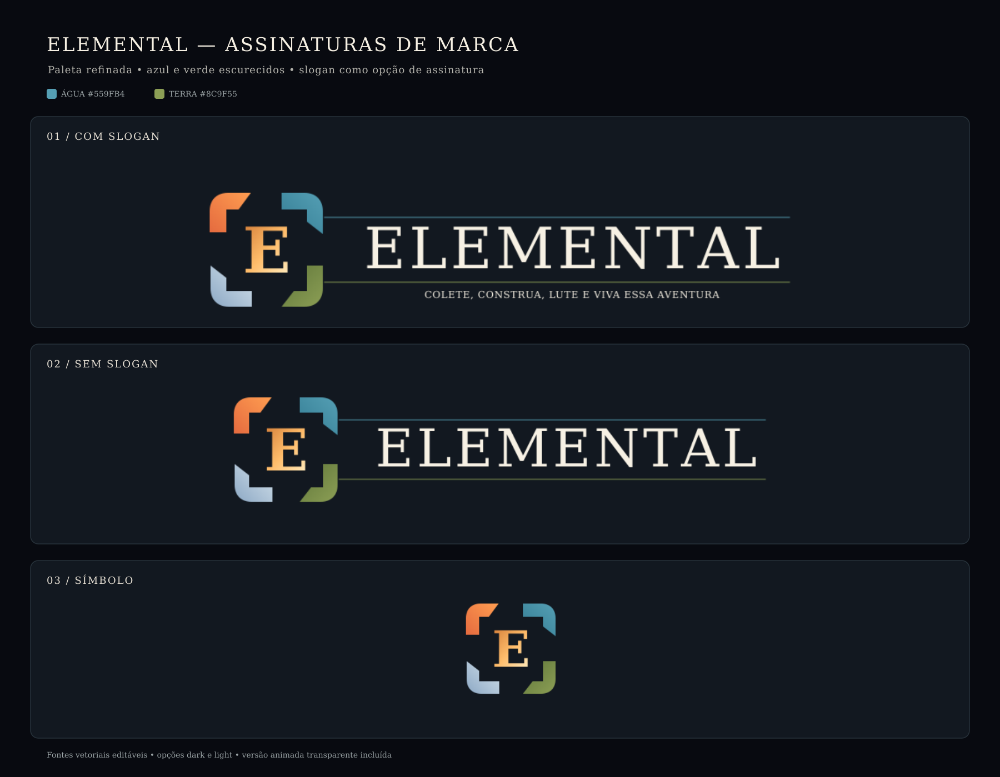

# Elemental — pacote de identidade

Este pacote reúne três aplicações da marca Portal da Origem com a paleta de azul e verde escurecida. Os traços que saem das forças azul e verde terminam próximos ao nome, com pontas suaves. A assinatura usa “Colete, construa, lute e viva essa aventura” logo abaixo do traço verde, centralizada sob “ELEMENTAL”.

## Arquivos

- `elemental-signature-tagline-dark.svg` / `.png`: assinatura colorida com slogan, para fundos escuros.
- `elemental-signature-tagline-light.svg` / `.png`: assinatura colorida com slogan, para fundos claros.
- `elemental-signature-dark.svg` / `.png`: assinatura colorida sem slogan, para fundos escuros.
- `elemental-signature-light.svg` / `.png`: assinatura colorida sem slogan, para fundos claros.
- `elemental-symbol.svg` / `elemental-symbol-1024.png`: símbolo sozinho, sem nome ou slogan.
- `elemental-brand-board.svg` / `.png`: prancha de apresentação das três opções.

Os SVGs e PNGs têm fundo transparente. “Dark” e “light” indicam a cor das letras e o fundo recomendado: a versão dark usa letras marfim sobre superfícies escuras; a light usa letras azul-noite sobre superfícies claras. Os contornos do monograma e do nome são vetoriais. O slogan permanece como texto editável em DejaVu Serif; a licença e procedência da família estão em `../NOTICE.md`.

## Paleta desta proposta

| Elemento | Gradiente |
| --- | --- |
| Água | `#347D94` → `#559FB4` |
| Terra | `#60763A` → `#8C9F55` |
| Fogo, ar e núcleo | Mantêm os tons da identidade aprovada |

O slogan é uma opção de assinatura, não parte obrigatória do logotipo. Use a versão sem slogan quando o espaço ou a escala forem reduzidos; use o símbolo sozinho para ícones e avatares.

## Aplicações

- **Com slogan:** materiais de marca e apresentação em que a frase possa ser lida.
- **Sem slogan:** assinatura geral em interfaces e comunicações do jogo.
- **Símbolo:** ícones, avatares e espaços compactos.

## Motion

A animação sem fundo está em [`../../motion/elemental-logo-reveal.svg`](../../motion/elemental-logo-reveal.svg) e [`../../motion/elemental-logo-reveal.mov`](../../motion/elemental-logo-reveal.mov). O SVG é a fonte editável; o MOV preserva transparência e leva o slogan na mesma posição do pacote estático.
