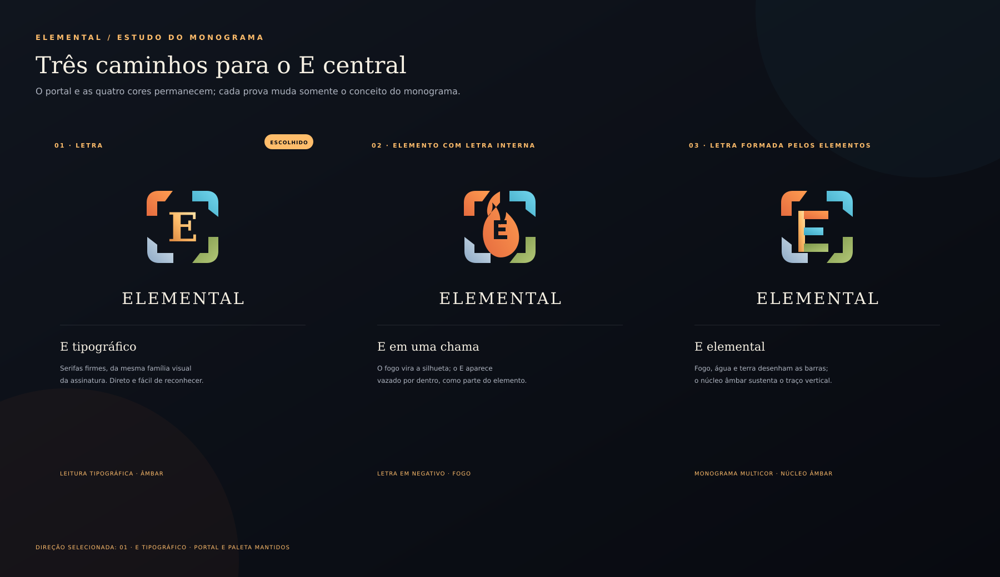

# Identidade visual desktop Elemental

## Referência e estado

A arte de fundo já distribuída em `data/images/background.png` é a arte hero aprovada do site Elemental. Este documento registra o sistema visual do cliente desktop; não altera o site nem seleciona sozinho o logotipo final.

O responsável aprovou a paleta escura com acento âmbar. A composição aprovada coloca o painel preto/dourado de login à esquerda; cadastro e criação de personagem aparecem em modais centro-direita sobre a tela desfocada; na charlist, a lista fica à esquerda e a seleção atualiza a representação visual e os dados do personagem na área central. A implementação completa das telas ocorre nas tasks T6.5 e T6.6.

## Tokens

| Uso | Cor | Valor |
| --- | --- | --- |
| Fundo noite | `#080A10` | Fundo de painel e modal |
| Superfície | `#1B202B` | Cartões e superfícies secundárias |
| Superfície elevada | `#252D38` | Hover e controles elevados |
| Entrada | `#10151D` | Campos de texto |
| Texto principal | `#F7F1E4` | Títulos e controles |
| Texto secundário | `#AEB4C0` | Instruções e dados auxiliares |
| Âmbar | `#FFBD6B` | Borda principal e ação |
| Foco | `#FFE2A7` | Indicação de foco |
| Fogo | `#FF9E51` | Estado pressionado/elemental |
| Água | `#74D7EE` | Acento elemental |
| Terra | `#B3C878` | Acento elemental |
| Ar | `#D6E3EC` | Acento elemental |
| Erro | `#E56B6B` | Erros recuperáveis |
| Borda sutil | `#39424E` | Separação de superfície |

Espaçamentos-base: 8, 16 e 24 px. Os estilos nativos ficam em `modules/client_entergame/elemental_brand.otui` e usam fontes já incluídas no cliente. O primeiro uso aplica o contorno de identidade ao login e à janela de cadastro, mantendo os callbacks e serviços existentes.

## Identidade selecionada

O responsável rejeitou as duas primeiras propostas e pediu um rebranding que use a paleta Elemental. Em 2026-10-16, escolheu a prova 01 do Portal da Origem: um E serifado, em âmbar, dentro das quatro forças. As propostas rejeitadas permanecem arquivadas em `docs/branding/mark-candidates/` como histórico.

O **Portal da Origem** deriva do ponto de luz dourado e das quatro forças visíveis na arte hero do site. O pacote oficial de fontes vetoriais, exportações PNG e variantes monocromáticas está em [`design/`](../../design/README.md). A seleção da marca está resolvida; a aplicação visual no cliente e em outras superfícies segue suas tarefas próprias. O site não foi alterado.

Na primeira integração runtime, a assinatura em PNG substitui o texto antigo "Elemental" do rodapé e aparece no painel de fundo, acima dos painéis legados. O símbolo e o wordmark renderizam em 1366×768 e 1920×1080. Esta colocação é provisória para a tela de entrada atual: o redesign do login posicionará a marca no banner lateral; o rodapé e demais elementos legados serão tratados nas tasks seguintes.

As três provas e o histórico da proposta estão em [`rebranding/portal/`](rebranding/portal/README.md).

